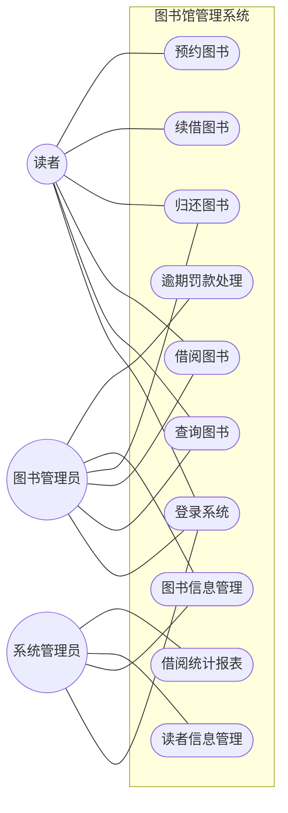
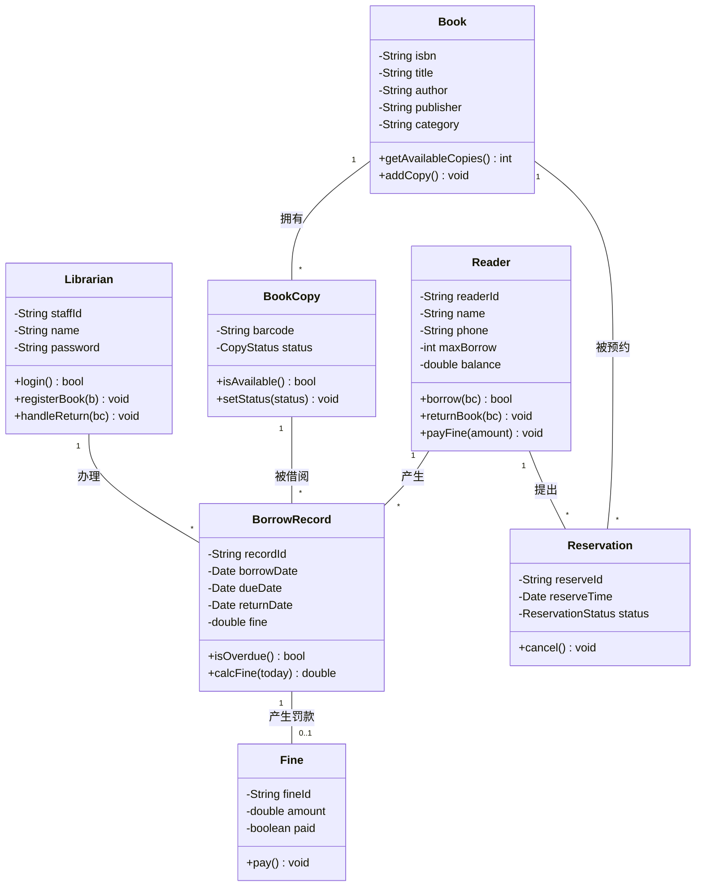
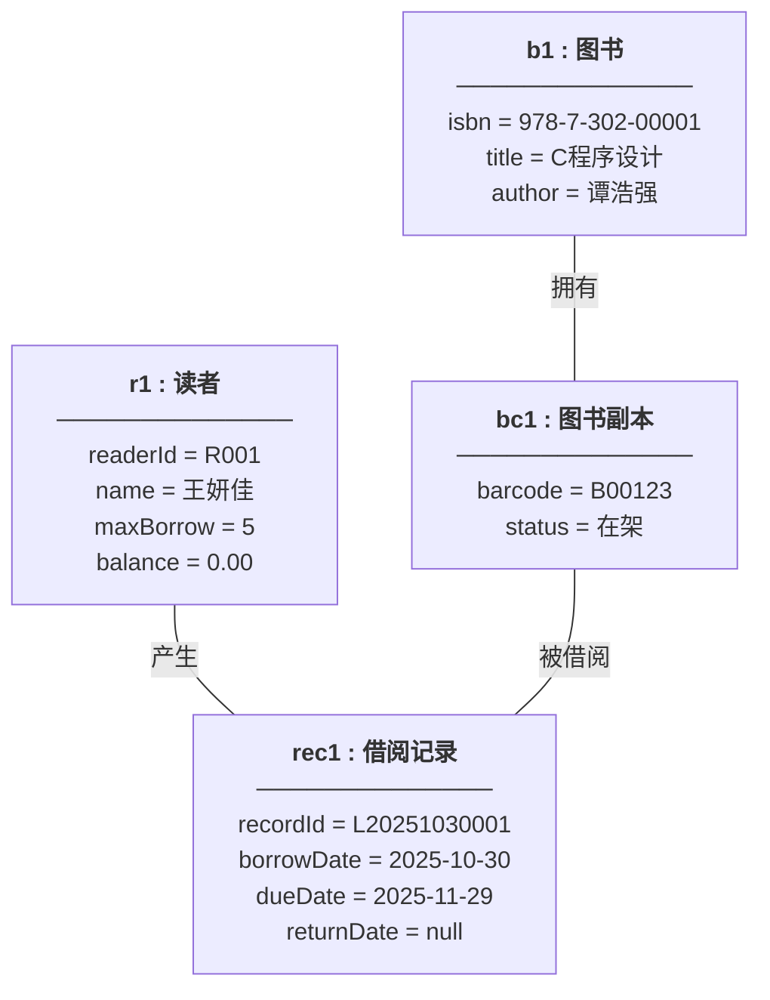
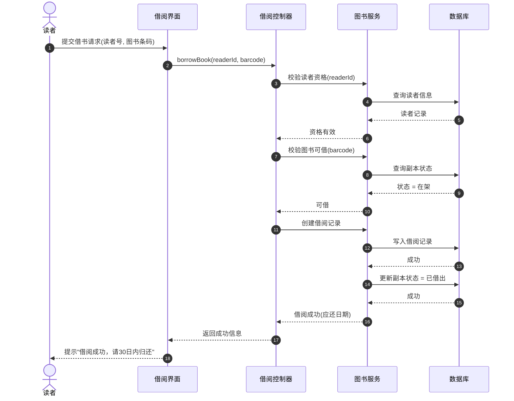
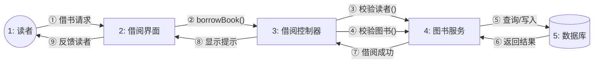
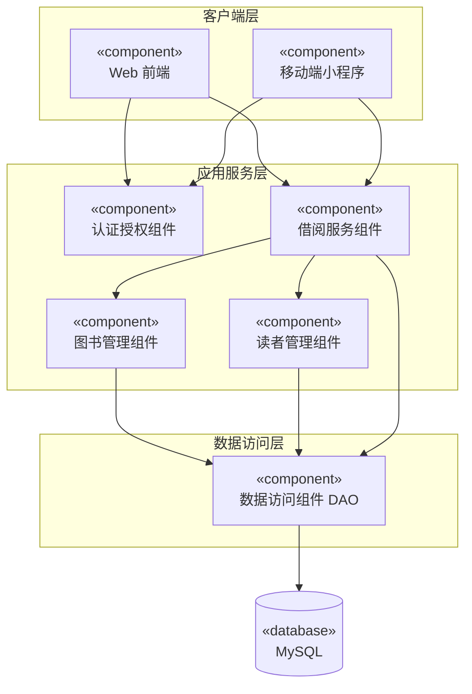
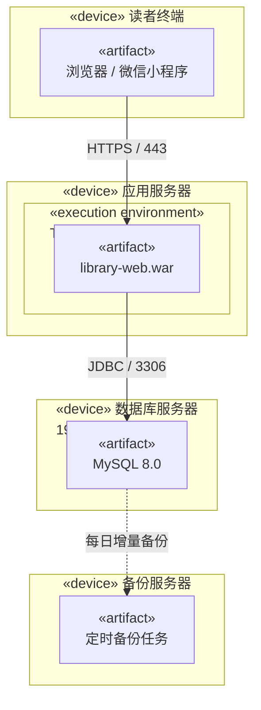
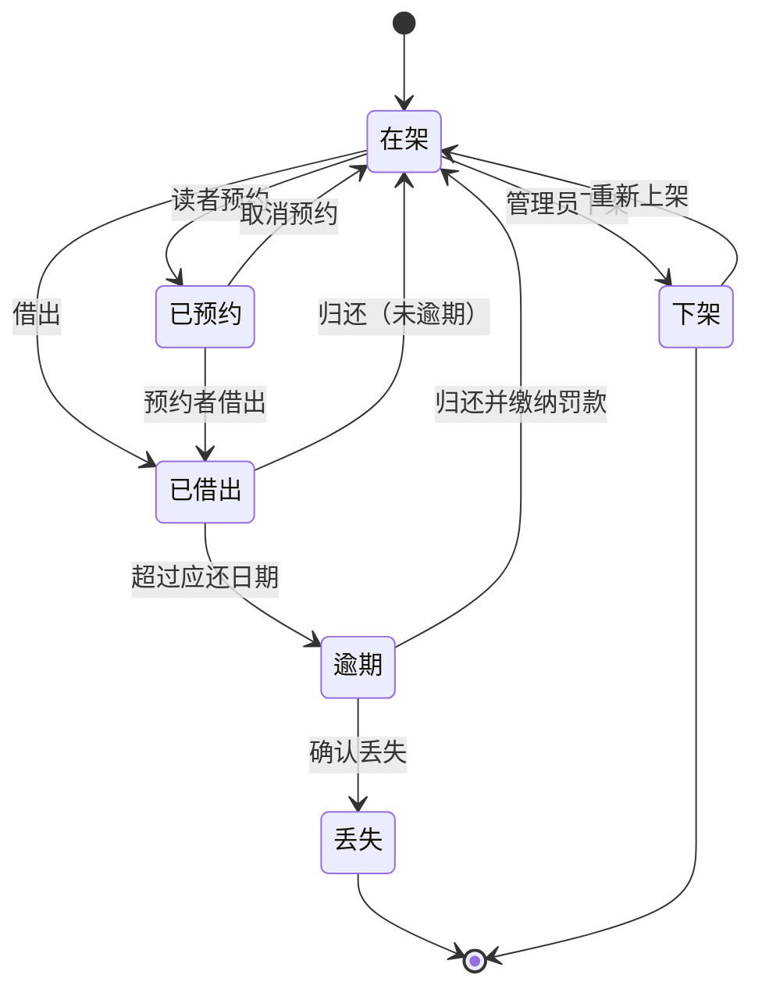
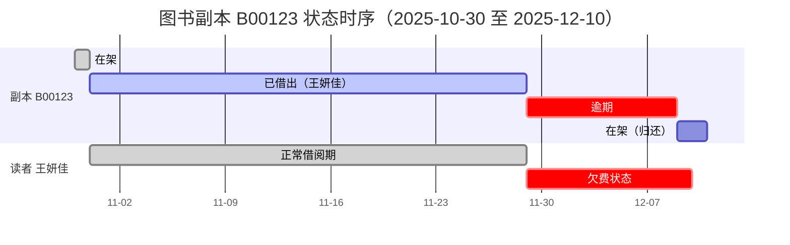

# 贪吃蛇大作战——修改玩家昵称 用例描述

| 项目 | 内容 |
| --- | --- |
| **用例名称** | 修改玩家昵称 |
| **参与者** | 贪吃蛇大作战小程序玩家 |
| **前置条件** | 1. 玩家已成功授权登录小程序；<br>2. 玩家已进入游戏主界面，并点击进入“个人中心”或“设置”页面。 |
| **后置条件** | 系统成功更新该玩家的昵称数据，并在个人主页、游戏排行榜中显示新的昵称。 |
| **主事件流<br>（正常流程）** | 1. 玩家在个人中心点击“修改昵称”或“编辑资料”按钮；<br>2. 系统弹出昵称输入界面，并带入玩家当前的旧昵称；<br>3. 玩家删除旧昵称，输入新的昵称；<br>4. 玩家点击“保存”或“确认修改”按钮；<br>5. 系统验证新昵称（是否包含敏感词、是否超出字数限制、是否包含特殊符号）；<br>6. 验证通过，系统后台保存新昵称数据；<br>7. 系统提示“修改成功”，并自动返回个人中心页面，展示更新后的新昵称。 |
| **备选事件流<br>（异常/分支流程）** | 情况A：昵称包含敏感词或格式错误<br>1. 玩家输入的昵称包含违规词汇、特殊符号，或长度超过限制；<br>2. 玩家点击“保存”；<br>3. 系统验证不通过，提示“昵称包含敏感词（或格式不正确），请重新输入”；<br>4. 玩家根据提示修改昵称，重新点击保存（回到主事件流步骤4）。<br><br>情况B：网络连接异常<br>1. 玩家输入新昵称并点击“保存”时，设备网络断开；<br>2. 系统无法连接服务器，提示“网络异常，请检查网络设置”；<br>3. 玩家恢复网络后，重新点击“保存”（回到主事件流步骤4）。<br><br>情况C：玩家中途放弃修改<br>1. 玩家打开修改界面后，突然不想改了；<br>2. 玩家点击界面上的“取消”按钮或系统自带的“返回”键；<br>3. 系统不保存任何修改，直接退回到个人中心页面。 |

> 备注：本游戏允许不同玩家使用相同昵称，因此不存在“昵称重名”的备选流程。

---

# 作业二：图书馆管理系统 UML 建模

> **图形说明**：以下 10 张图均使用 **Mermaid** 语法绘制。可在 Typora、Obsidian、VS Code（安装 Mermaid 插件）、GitHub 中直接渲染；如需插入 Word，可在 [mermaid.live](https://mermaid.live) 打开后导出 PNG/SVG。

## 一、系统概述

图书馆管理系统面向**读者**、**图书管理员**、**系统管理员**三类角色，实现图书的查询、借阅、归还、续借、预约，以及图书与读者信息维护、逾期罚款、统计报表等功能。

核心业务对象：图书（Book）、图书副本（BookCopy）、读者（Reader）、管理员（Librarian）、借阅记录（BorrowRecord）、预约（Reservation）、罚款（Fine）。

---

## 二、用例图（Use Case Diagram）



**说明**：读者主要完成自助类操作；图书管理员负责柜台业务（借还、罚款）；系统管理员负责基础数据维护与统计。

---

## 三、类图（Class Diagram）



**说明**：`Book` 与 `BookCopy` 是**一对多**（一本书有多个可借副本）；`BorrowRecord` 是读者、副本、管理员三者之间的关联类，承载借阅日期与罚款信息。

---

## 四、对象图（Object Diagram）



**说明**：对象图是类图在某一时刻的**实例快照**，展示 2025-10-30 王妍佳借出《C程序设计》副本 B00123 这一具体场景。

---

## 五、时序图（Sequence Diagram）



**说明**：描述"借书"这一用例的正常流程，体现界面层 → 控制层 → 服务层 → 数据层的调用顺序。

---

## 六、活动图（Activity Diagram）

```mermaid
flowchart TD
    S((开始)) --> A1[读者出示借书证与图书]
    A1 --> A2[管理员扫描借书证]
    A2 --> D1{借书证是否有效?}
    D1 -- 否 --> E1[提示：借书证无效或已挂失]
    E1 --> END((结束))
    D1 -- 是 --> D2{借阅数量是否超限?}
    D2 -- 是 --> E2[提示：已达最大借阅数量]
    E2 --> END
    D2 -- 否 --> D3{图书副本是否可借?}
    D3 -- 否 --> E3[提示：该书已借出或已被预约]
    E3 --> END
    D3 -- 是 --> A3[生成借阅记录]
    A3 --> A4[更新副本状态为"已借出"]
    A4 --> A5[打印借书凭条]
    A5 --> END
```

**说明**：展示借书业务的活动流，包含 3 个判断分支与各自的异常出口。

---

## 七、协作图 / 通信图（Collaboration / Communication Diagram）

> 说明：这是 UML 1.x 的**旧称（Legacy）协作图**，UML 2.0 起改名为**通信图**。它与时序图语义等价，区别在于**强调对象之间的链接关系**，消息用编号表示先后顺序。



**说明**：用序号标注消息顺序，对象之间的连线即"链接（Link）"，对应类图中的关联关系。

---

## 八、组件图（Component Diagram）



**说明**：按三层架构划分组件，箭头表示依赖（调用）关系。

---

## 九、部署图（Deployment Diagram）



**说明**：展示系统的物理部署拓扑与节点间的通信协议。

---

## 十、状态图（State Diagram）



**说明**：描述**图书副本**在其生命周期内的状态迁移（在架 / 已预约 / 已借出 / 逾期 / 丢失 / 下架）。

---

## 十一、时间图（Timing Diagram）



**时间轴对照表**：

| 时间 | 副本 B00123 状态 | 读者 王妍佳 状态 | 说明 |
| --- | --- | --- | --- |
| 2025-10-30 | 在架 | 正常 | 图书在库可借 |
| 2025-10-31 | 已借出 | 正常借阅 | 借出成功，应还日 2025-11-29 |
| 2025-11-29 | 逾期 | 欠费累积 | 超过应还日期，开始计罚 |
| 2025-12-09 | 在架 | 结清 | 归还并缴纳罚款，恢复可借 |

**说明**：时间图强调**状态随时间的变化**，横轴为时间，纵轴为被关注对象的状态。

---

## 十二、总结

| 序号 | 图类型 | 建模视角 | 本系统对应内容 |
| --- | --- | --- | --- |
| 1 | 用例图 | 系统功能与角色 | 读者/管理员/系统管理员的 10 个用例 |
| 2 | 类图 | 静态结构 | 图书、副本、读者、借阅记录等 7 个类 |
| 3 | 对象图 | 静态结构实例 | 一次借书场景的具体对象快照 |
| 4 | 时序图 | 动态交互（按时间） | 借书流程的消息调用顺序 |
| 5 | 活动图 | 动态流程 | 借书业务的活动流转与分支 |
| 6 | 协作图 | 动态交互（按链接） | 借书流程的对象链接与消息编号 |
| 7 | 组件图 | 物理/逻辑组成 | 三层架构的组件依赖 |
| 8 | 部署图 | 物理部署 | 客户端/应用/数据库/备份四个节点 |
| 9 | 状态图 | 单对象状态机 | 图书副本的生命周期状态 |
| 10 | 时间图 | 状态与时间关系 | 副本与读者状态随时间的变化 |
