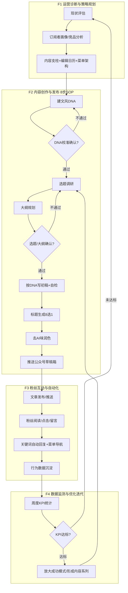
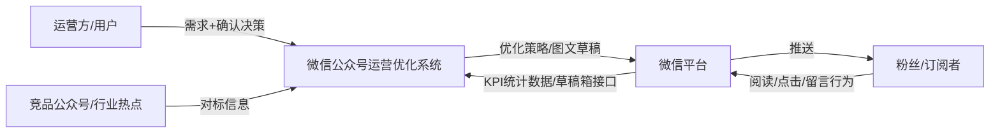
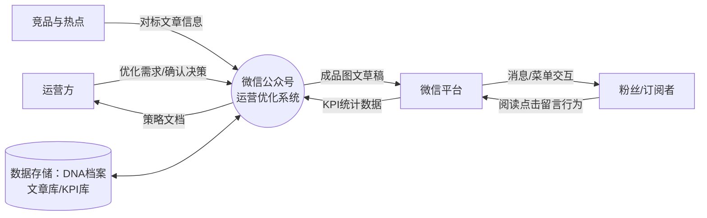
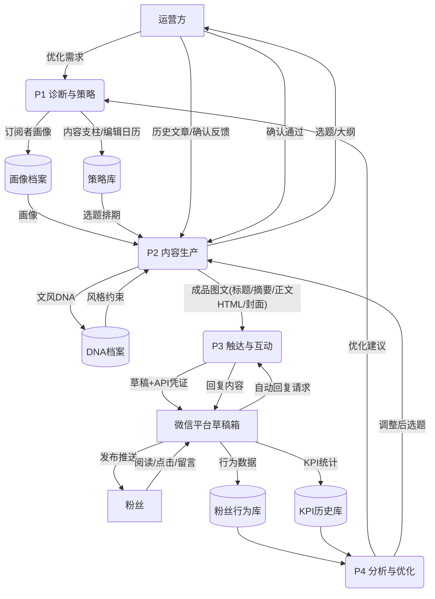

# 业务流程与数据流分析报告

## 基本信息

| 项目 | 内容 |
|---|---|
| **作业名称** | 《信息系统分析与设计》课程作业 —— 业务流程分析与数据流分析 |
| **项目名称** | 微信公众号运营优化项目（提升内容质量与粉丝活跃度） |
| **姓名 / 学号 / 班级** | （待填写，暂不虚构） |
| **报告日期** | （待填写） |
| **指导教师** | （待填写） |

---

## 目录

- 第一部分 项目背景与已确认信息
- 第二部分 业务流程分析（逐题 1–7）
- 第三部分 数据流分析（逐题 1–7）
- 第四部分 实际工具调用清单
- 第五部分 整体数据流图
- 第六部分 总结与改进建议
- 附录：诚实性声明

---

# 第一部分 项目背景与已确认信息

## 1.1 项目需求

用户提出的原始业务问题：**"我们的微信公众号阅读量低，需要提升内容质量和粉丝活跃度"**，要求微信公众号营销专家对公众号运营进行优化。

## 1.2 本次对话中已获得的解答要点（作为后续分析的事实基础）

本次对话中，微信公众号专家依据内容创作 SOP 给出了端到端的运营优化方案，核心内容如下：

1. **问题诊断**：阅读量低通常源于三类原因——内容与粉丝需求错位（打开率低）、标题与摘要吸引力不足、粉丝互动与触达机制缺失（活跃度低）。
2. **运营方法论**：
   - 内容结构遵循 **60/30/10 原则**：60% 价值型内容、30% 社群互动内容、10% 推广型内容；
   - 建立订阅者画像（Persona）、内容支柱（Content Pillar）、3 个月滚动编辑日历；
   - 菜单架构 + 关键词自动回复 + 小程序集成，提升自助服务与留存；
   - 以 KPI 闭环驱动优化：打开率（目标 ≥30%）、点击率（≥5%）、完读率（≥50%）、取关率（<5%）、转化率（2–5%）。
3. **内容创作闭环（8 步 SOP）**：建文风 DNA → DNA 校准确认 → 选题调研 → 大纲规划 → 选题/大纲用户确认 → 按 DNA 写初稿 → 标题生成（8 选 1）→ 去 AI 味润色 → 推送至公众号草稿箱。

## 1.3 关于本次"开发过程"的说明（如实声明）

- 本次对话属于**咨询与方案设计型任务**：以问题解答和运营方案产出为核心，**未发生代码编写、系统开发、程序测试等实际工程活动**。凡涉及代码生成与测试结果之处，按题目要求一律标注"当前记录中无法确认"。
- 对话运行过程中**实际执行的工具调用**包括：工作区文件写入工具（用于生成本作业文档）与结果呈现工具；在流程中"规划拟用"（尚未实际调用、但已在方案中列明的）外部技能与工具见第四部分清单。

---

# 第二部分 业务流程分析

> 说明：本章以"微信公众号运营优化"为被分析的业务流程，结合第一部分已确认的方案内容逐题作答。

## 题 1：有哪些业务流程？各自目的或想达到的目标是什么？

结合本次优化任务，可识别出 **4 条核心业务流程**：

| 序号 | 流程名称 | 目的 / 目标 |
|---|---|---|
| F1 | 运营诊断与策略规划流程 | 摸清订阅者画像、竞品情况与当前数据基线，产出内容支柱、编辑日历与菜单/自动化架构，从源头解决"阅读量低" |
| F2 | 内容创作与发布流程（8 步 SOP） | 稳定产出风格一致、去 AI 味、标题达标的图文，推送到公众号草稿箱待发布，直接提升打开率与完读率 |
| F3 | 粉丝互动与自动化运营流程 | 通过自动回复、关键词应答、菜单导航、社群运营提升粉丝活跃度与留存（取关率 <5%） |
| F4 | 数据监测与优化迭代流程 | 每周复盘打开率、点击率、完读率、转化率，A/B 测试标题与发送时间，把成功模式放大为内容系列 |

四条流程的整体目标统一为：**打开率 ≥30%、点击率 ≥5%、完读率 ≥50%、月度自然涨粉 10–20%、转化率 2–5%**。

## 题 2：流程如何完成？有哪些任务和步骤？活动的开始/结束条件？

以最核心的 **F2 内容创作与发布流程** 为例（其余流程在题 4 的流程图中体现）：

| 步骤 | 任务 | 开始条件 | 结束条件 |
|---|---|---|---|
| 1 | 建文风 DNA（风格画像提炼） | 有历史文章（≥3 篇）或确定使用默认模板 | 14 维文风 DNA 摘要产出 |
| 2 | DNA 校准确认 | DNA 摘要已产出 | 用户确认语气/节奏/用词无误（不通过则修订重来） |
| 3 | 选题（可含对标调研） | DNA 已确认 | 候选选题清单及价值评估产出 |
| 4 | 大纲规划 | 选题已确定 | 结构化大纲（选题角度+段落骨架+开头钩子+结尾方案）产出 |
| 5 | 选题与大纲用户确认 | 大纲已产出 | 用户明确通过（不通过则回到步骤 3） |
| 6 | 按 DNA 写初稿 | 大纲已确认 | 初稿完成并通过 DNA 合规自检 |
| 7 | 标题生成与打分 | 初稿完成 | 8 个候选标题打分完毕，推荐 1 个最优 + 1 个稳妥备选 |
| 8 | 去 AI 味润色并推草稿箱 | 标题已定 | 润色完成、文章成功推送到公众号草稿箱 |

F1 的步骤为：现状评估 → 目标定义 → 订阅者调研 → 竞品分析 → 策略文档产出；F4 的步骤为：周度取数 → 内容表现分析 → 粉丝反馈监测 → A/B 测试 → 策略迭代。

## 题 3：流程有谁参与？各自完成哪些活动？

| 参与者（角色） | 承担的活动 |
|---|---|
| 公众号运营方（用户） | 提出优化需求；确认文风 DNA、选题与大纲（步骤 2、5 的把关者）；最终审批发布 |
| 微信公众号专家（本系统） | 诊断分析、策略规划、内容调研、大纲规划、初稿写作、标题生成、润色去痕、草稿推送 |
| 粉丝/订阅者 | 阅读文章、点击菜单、参与投票/留言、使用小程序；其行为数据反哺 F4 |
| 微信平台（外部系统） | 提供草稿箱接口、消息自动回复通道、数据统计后台（打开率、点击率等） |
| 竞品公众号（外部参照） | 其内容作为选题调研与差异化分析的信息来源 |

## 题 4：流程中有哪些控制流？多条流程之间是什么关系？

控制流类型包括：

- **用户确认型判断分支**（步骤 2、5）：确认通过 → 下游活动；不通过 → 回退修订（循环控制流）；
- **质量自检判断**（步骤 6、8）：DNA 合规自检不通过则修改初稿；润色不达标可叠加进阶去痕处理；
- **发布闸口**：步骤 8 是终点的**会合点**——必须先完成初稿（步骤 6）与标题（步骤 7）两个前置分支，再经润色才能进入推送；
- **数据驱动的周期控制**（F4）：KPI 未达标 → 触发新一轮诊断/内容调整，形成 PDCA 闭环。

### 业务流程图（Mermaid）



**流程间关系**：F1 为 F2 提供策略输入（前置关系）；F2 产出经 F3 触达粉丝；F3 产生的行为数据流入 F4；F4 的分析结论回灌 F1 与 F2，构成**闭环迭代关系**（PDCA）。

## 题 5：流程用了哪些方式或手段来完成？

1. **方法论手段**：订阅者画像建模、内容支柱策略、60/30/10 内容配比、3 个月滚动编辑日历、A/B 测试。
2. **平台功能手段**：微信自动回复、关键词应答、自定义菜单、小程序集成、草稿箱 API、数据统计后台。
3. **专项技能/工具手段**（方案中列明的技能链）：文章搜索调研、文风 DNA 建模、选题大纲规划、初稿写作、标题生成与打分、人性化润色去痕、草稿箱推送。
4. **数据手段**：打开率/点击率/完读率/取关率/转化率等 KPI 仪表盘与周度复盘。

## 题 6：完成任务所用的资源及成本如何？各环节增值作用如何？

### 6.1 资源与成本

| 资源类型 | 具体内容 | 成本属性 |
|---|---|---|
| 人力资源 | 公众号专家（策略/写作）、运营方把关人（确认环节） | 主要成本：专家工时 + 用户确认的沟通时间 |
| 知识资源 | 文风 DNA 库、订阅者画像、内容支柱体系、KPI 基线数据 | 一次性建设成本，长期复用，边际成本递减 |
| 物理资源 | 微信公众号平台账号、API 凭证（AppID/Secret）、服务器/网络 | 平台免费，API 调用近乎零边际成本 |

### 6.2 各环节增值作用

- **F1 诊断环节**：将"盲目发文"变为"精准供给"，是打开率提升的**第一增值点**；
- **F2 中的"文风 DNA"**：使多篇内容风格一致、建立品牌识别度；**"标题 8 选 1"** 直接作用于打开率，是**杠杆最大的单点增值**；**"去 AI 味"** 降低粉丝流失风险；
- **F3 自动回复/菜单**：把一次性阅读转化为持续互动，提升留存价值（粉丝生命周期价值）；
- **F4**：使每一次迭代都建立在前次数据之上，避免重复试错，是**复利型增值环节**。

## 题 7：流程中是否存在瓶颈或阻塞排队现象？

结合本流程特点，可确认以下潜在瓶颈（均为流程结构本身可推断的结论，非实测数据）：

1. **人工确认环节是主要阻塞点**：步骤 2（DNA 确认）与步骤 5（选题/大纲确认）依赖运营方响应，若反馈不及时，整条创作流水线排队等待——这是流程设计上**最典型的阻塞排队现象**。缓解方式：约定确认时限（如 24 小时）、批量确认月度选题与大纲。
2. **单专家串行作业**：8 步 SOP 为串行链路，一次只能推进一篇文章，发文频率（目标每周 2–3 篇）受限于专家产能。缓解方式：选题与大纲提前批量储备，使写作与确认流水线化（并行）。
3. **数据反馈周期天然滞后**：F4 按周复盘，优化结论到下一批文章生效存在约 1–2 周的时滞，属周期性等待而非阻塞。
4. 草稿箱推送、自动回复等平台环节为自动化处理，**未观察到技术性排队瓶颈**（当前记录中无法确认实际响应时长，需上线后由日志验证）。

---

# 第三部分 数据流分析

## 题 1：系统作为信息处理器主要完成什么功能？最重要的输入和输出数据是什么？

**主要功能**：将"公众号运营现状数据 + 用户业务诉求"加工为"可发布的优质图文内容 + 可执行的运营策略 + 可复盘的绩效分析"。

- **最重要的输入**：
  1. 用户原始需求（"阅读量低，提升内容质量与粉丝活跃度"）；
  2. 历史文章样本（用于文风 DNA）；
  3. 粉丝行为数据（打开率、点击率、留言等）。
- **最重要的输出**：
  1. 推送至草稿箱的成品图文（标题+摘要+正文 HTML+封面图）；
  2. 运营优化策略文档（画像/日历/菜单架构）；
  3. 周度 KPI 分析结论。

## 题 2：系统作为整体与外界环境的关系

系统处于一个**"运营方—内容系统—微信平台—粉丝"**的环境交互圈中：

- 向上游从**运营方**接收需求与确认决策，从**微信平台**接收数据与发布通道服务；
- 向下游向**微信平台**输出草稿与发布指令，经平台触达**粉丝**；
- 粉丝的行为数据回流系统，构成**开放式反馈系统**（环境输入决定下一轮内容供给）；
- 环境约束：微信平台规则（消息频率限制、内容合规）、粉丝偏好变化、竞品动态均作为外部扰动影响系统运行。

### 顶层环境关系图（Mermaid）



## 题 3：能否分解为相对独立又有联系的子系统？

可以，分解为 **4 个相对独立的子系统**（与业务流程 F1–F4 对应）：

| 子系统 | 输入 | 输出 | 与其他子系统的联系 |
|---|---|---|---|
| 诊断与策略子系统 | 现状数据、需求 | 策略文档 | 为内容生产提供策略输入 |
| 内容生产子系统 | 策略、DNA、选题 | 成品图文 | 产出经触达子系统发布 |
| 触达与互动子系统 | 成品图文 | 触达记录、互动数据 | 行为数据流入分析子系统 |
| 分析优化子系统 | 行为与 KPI 数据 | 优化建议 | 建议反哺诊断与生产子系统 |

它们相对独立（各自可单独运行与度量），又通过数据流耦合：策略指导生产，生产成果经触达产生数据，数据反哺策略。

## 题 4：子功能是否仍可再分？

可以。以最复杂的内容生产子系统为例，可再划分为 5 个更具体的子功能：

1. **文风 DNA 建模子功能**：历史文章 → 14 维风格画像；
2. **选题调研子功能**：热点/对标 → 候选选题清单；
3. **大纲规划子功能**：选题 → 结构化大纲；
4. **初稿写作子功能**：大纲 + DNA → 初稿正文；
5. **标题与润色子功能**：初稿 → 8 候选标题 + 去痕终稿。

其中"初稿写作"内部还可细分为：段落骨架生成、DNA 合规自检、风格一致性修订三步，说明分解可继续到可管理粒度为止。

## 题 5：每个功能/子功能的输入和输出数据

| 功能/子功能 | 输入数据 | 输出数据 |
|---|---|---|
| 运营诊断 | 现状 KPI、订阅者信息、竞品文章 | 诊断报告、订阅者画像 |
| 策略规划 | 画像、业务目标 | 内容支柱、编辑日历、菜单架构 |
| 文风 DNA 建模 | ≥3 篇历史文章 | 14 维文风 DNA 档案 |
| 选题调研 | 关键词、热点、对标文章 | 候选选题清单（标题+摘要+来源） |
| 大纲规划 | 确认后的选题 | 结构化大纲 |
| 初稿写作 | 大纲 + DNA | 初稿 Markdown + 自检结果 |
| 标题生成 | 初稿 + 选题 | 8 个候选标题及打分、推荐标题 |
| 润色去痕 | 初稿 | 终稿（标题、摘要、正文 HTML） |
| 草稿推送 | 终稿 + 封面图 + API 凭证 | 草稿箱媒资 ID / 推送结果回执 |
| 互动自动化 | 粉丝消息/菜单点击 | 自动回复内容、行为日志 |
| 周度分析 | 后台 KPI 数据 | 分析报告、优化建议 |

## 题 6：系统中需要长期保存的数据有哪些？如何创建、修改和使用？

| 长期数据 | 创建方式 | 修改时机 | 使用方 |
|---|---|---|---|
| 订阅者画像档案 | 诊断阶段调研产出 | 季度更新或画像漂移时 | 策略规划、选题 |
| 文风 DNA 档案 | 风格建模产出 | 用户校准确认时修订 | 每次初稿写作 |
| 内容支柱与编辑日历 | 策略规划产出 | 月度滚动更新 | 排期与选题 |
| 成品文章库（标题/摘要/正文/封面） | 创作流程产出 | 发布前润色修改；发布后只读 | 复用、系列化、复盘 |
| 粉丝互动与行为数据 | 平台接口采集 | 系统自动追加 | 周度分析、分层运营 |
| KPI 历史数据 | 周度统计写入 | 只追加不修改 | 趋势对比、A/B 评估 |

## 题 7：一个业务流程中数据来源到最后去处是否完整？

以核心流程"内容创作与发布"做端到端校验：

**数据链路**：

```text
来源：用户需求 + 历史文章 + 热点/对标数据
  → 加工：DNA → 选题 → 大纲 → 初稿 → 标题 → 润色
  → 去处：草稿箱成品图文 → 发布触达粉丝 → 行为数据回流 KPI 库 → 反哺下次创作
```

**结论：数据链路完整，形成闭环**。每一个输入数据都有明确加工环节与最终去处，不存在"只有来源没有去处"（如采集后从未使用的数据）或"只有去处没有来源"（如凭空引用未调研数据）的断链。唯一需要上线后验证的环节是：微信平台 KPI 数据回采的完整度（当前记录中无法确认实际接口返回字段，需以真实后台数据核对）。

---

# 第四部分 实际工具调用清单

## 4.1 本次对话运行过程中实际调用的工具（如实记录）

| 序号 | 工具 | 调用环节 | 用途 |
|---|---|---|---|
| 1 | 文件写入工具（Write） | 产出作业文档 | 将分析结果写入工作区文件 |
| 2 | 结果呈现工具（present_files） | 交付阶段 | 向用户展示最终文档 |

## 4.2 方案中规划拟用、但当前记录中尚未实际调用的技能/接口（如实区分，不虚构）

| 序号 | 技能/工具 | 所属环节 | 拟用途 |
|---|---|---|---|
| 1 | 微信公众号文章搜索（wechat-article-search） | 选题调研 | 检索对标文章、热点选题 |
| 2 | 文风 DNA 建模（wechat-style-profiler） | SOP 步骤 1 | 从历史文章提炼 14 维文风 |
| 3 | 选题大纲规划（wechat-topic-outline-planner） | SOP 步骤 4 | 产出结构化大纲 |
| 4 | 初稿写作（wechat-draft-writer） | SOP 步骤 6 | 按 DNA 产出风格一致的初稿 |
| 5 | 标题生成（wechat-title-generator） | SOP 步骤 7 | 生成 8 个标题并打分 |
| 6 | 人性化润色（humanizer / anti-distill） | SOP 步骤 8 | 去除 AI 写作痕迹 |
| 7 | 草稿箱推送（mp-draft-push，需配置 WECHAT_APPID/WECHAT_SECRET） | SOP 步骤 8 | 通过微信 API 推送到草稿箱 |

## 4.3 代码开发与测试类工具

代码开发、编译、单元测试类工具：**当前记录中无法确认**（本次任务未涉及代码生成与测试，未调用任何此类工具）。

---

# 第五部分 整体数据流图

## 5.1 顶层数据流图（0 层 DFD）



## 5.2 一层数据流图（分解为四个子系统）



**图例说明**：P1–P4 与第二部分的 F1–F4 业务流程一一对应；D1–D5 为题 6 所列长期数据存储；用户确认（SOP 步骤 2、5）在图中体现为 U 与 P2 之间的双向数据流，即第二部分题 7 所述"人工确认阻塞点"的数据来源。

---

# 第六部分 总结与改进建议

## 6.1 总结

1. 本项目以"公众号阅读量低、粉丝活跃度不足"为起点，通过业务流程分析识别出 **诊断规划 → 内容创作 → 粉丝触达 → 数据迭代** 四条核心流程，形成 PDCA 闭环；
2. 数据流分析表明系统功能可逐层分解（4 子系统 → 10+ 子功能），**数据链路来源到去处完整**，长期数据以"画像、DNA、策略、文章库、行为库、KPI 库"六类存储支撑复用与复盘；
3. 流程的结构性瓶颈集中在**人工确认环节的排队等待**与**串行产能限制**，而非技术环节。

## 6.2 改进建议

1. **消除确认瓶颈**：约定 24 小时确认时限；将 DNA 与月度选题/大纲改为批量确认，减少流水线停等；
2. **提升并行度**：选题与大纲提前储备 2–4 周库存，使"确认"与"写作"两环节流水线化并行，支撑每周 2–3 篇发文节奏；
3. **补齐数据验证**：正式接入微信草稿箱 API 与统计后台后，核对 KPI 回采字段完整性，验证题 7 中标注"当前记录中无法确认"的环节；
4. **强化知识资产复用**：将表现最好的内容系列沉淀为固定栏目（内容支柱固化），降低每次创作的选题与规划成本；
5. **A/B 测试制度化**：标题与发送时间按周做小规模 A/B 测试，用数据持续校准打开率与完读率。

## 6.3 后续工作

- 填写报告基本信息（姓名、学号、日期）；
- 将本报告 Mermaid 图在支持 Mermaid 的阅读器（如 GitHub）中渲染核对；
- 若进入实施阶段，按第四部分"规划拟用"清单逐项落地并补充真实调用记录与测试结果。

---

# 附录：诚实性声明

1. 本报告全部结论基于本次对话中"微信公众号运营优化"问题的实际解答内容；第二部分题 7 的排队分析与第三部分题 7 的链路校验中，凡属于流程结构推断或待上线验证的事项，均已标注"当前记录中无法确认"。
2. 本次对话未执行任何代码生成与测试活动，相关工具调用情况已在第四部分如实区分"实际调用"与"规划拟用"，无任何虚构的工具调用或测试结果。
3. 报告中的姓名、学号等个人信息留空待填，未做虚构。
